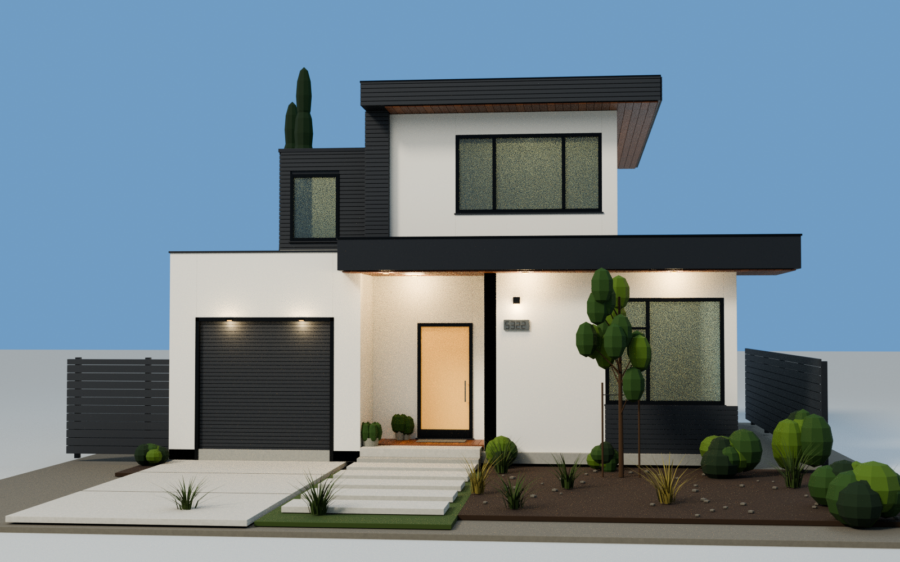

# Single-family home — Rhino model

Editable exterior study reconstructed from the supplied photograph.

- [Download the Rhino model (.3dm)](single_family_home.3dm?raw=true)
- [Download the complete bundle (.zip)](single_family_home_rhino.zip?raw=true)

Open the `.3dm` in Rhino 7 or 8. Units are metres. Use Rendered or Shaded mode and the saved named views.

The model contains 683 valid geometry objects on 14 layers, including 492 closed Brep solids. Walls, roofs, window frames, glazing, cladding and site details are individually editable. The written file was reopened and validated with rhino3dm; it was not tested in the Rhino desktop application.

Dimensions are approximate, using an assumed 2.5 m garage-door width. The main frontage is about 10.1 m, the highest roof is 6.925 m, and the inferred depth is 10.2 m. Rear and side elevations, interior surfaces and landscaping are simplified. This is a visual study, not a measured or construction model.

The ZIP contains the Rhino model, two rendered previews, notes, the reproducible Python generator, rendering source and validation results.

